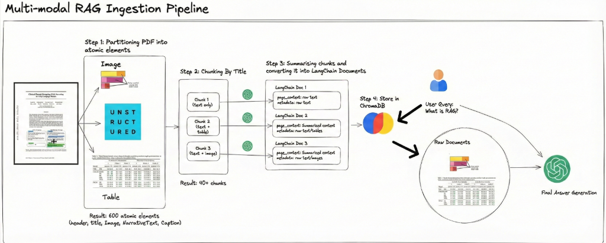

# Multimodal RAG: Production-Grade PDF Intelligence

A high-performance, multimodal Retrieval-Augmented Generation (RAG) system designed to ingest complex PDFs and provide intelligent answers using text, tables, and images. Featuring a sleek, minimalist dark-themed Streamlit UI and a robust CLI pipeline.


---

## 🚀 Key Features

- **Multimodal Intelligence**: Goes beyond text. The system extracts and understands images (charts, diagrams) and tables from PDFs.
- **AI-Enhanced Retrieval**: Uses multimodal LLMs to summarize chunks, making them highly searchable and context-aware.
- **Dual Interface**:
    - **Streamlit GUI**: A beautiful, minimal dark-themed dashboard for document management and chatting.
    - **CLI Pipeline**: A modular Python script for automated batch processing.
- **Source Attribution**: Transparently shows the exact text segments, base64 images, and HTML tables used to generate every answer.
- **Persistent Q&A Logging**: Automatically saves every interaction to `qna.json` for audit and history tracking.

---

## 🏗️ Architecture



---

## 🛠️ Tech Stack

- **Orchestration**: LangChain, LangChain-OpenAI
- **Processing**: Unstructured (PDF partitioning with `hi_res` strategy)
- **Vector DB**: ChromaDB
- **Embeddings**: Sentence-Transformers (`all-MiniLM-L6-v2`)
- **LLMs**: google/gemma-3-12b-it (Multimodal), Nvidia Nemotron (Summarization) via OpenRouter
- **Frontend**: Streamlit
- **Package Manager**: [uv](https://github.com/astral-sh/uv)

---

## 📦 Installation

This project uses `uv` for lightning-fast dependency management.

1. **Clone the repository**:
   ```bash
   git clone <repository-url>
   cd "Multimodal RAG"
   ```

2. **Set up Environment Variables**:
   Create a `.env` file in the root directory:
   ```env
   OPENAI_API_KEY=your_openrouter_api_key
   OPENAI_API_BASE=https://openrouter.ai/api/v1
   ```

3. **Install Dependencies**:
   ```bash
   uv sync
   ```

---

## 🖥️ Usage

### 1. Launch the Chatbot (GUI)
The primary way to interact with your documents. Upload PDFs via the sidebar, process them, and start chatting.
```bash
uv run streamlit run app.py
```

### 2. Run the Pipeline (CLI)
For quick testing or automation without a browser.
```bash
uv run python main.py --pdf "./content/attention.pdf" --query "What is the transformer architecture?"
```

---

## 📂 Project Structure

```text
├── app.py              # Streamlit Frontend
├── main.py             # Core RAG Pipeline & Logic
├── assets/             # Architecture diagrams and images
├── content/            # Directory for uploaded PDFs
├── dbv2/               # Persistent ChromaDB storage
├── qna.json            # History of questions and multimodal answers
├── rag_result.json     # Detailed retrieval metadata (last query)
├── pyproject.toml      # Dependency definitions
└── README.md           # This file!
```

---

## 🔍 How it Works

1. **Partitioning**: Extracts `hi_res` elements (Text, Tables, Images) from PDFs using `unstructured`.
2. **AI Summarization**: Chunks are processed by a Vision Model to create "searchable summaries" that describe visual content.
3. **Embedding**: Summaries are converted into vectors and stored in ChromaDB.
4. **Retrieval**: Top-K chunks are retrieved based on query similarity.
5. **Generation**: A multimodal prompt (text + extracted base64 images) is sent to GPT-4o-mini to generate the final, grounded answer.

---

## 📄 License
MIT License. Feel free to use and modify for your serious projects!
